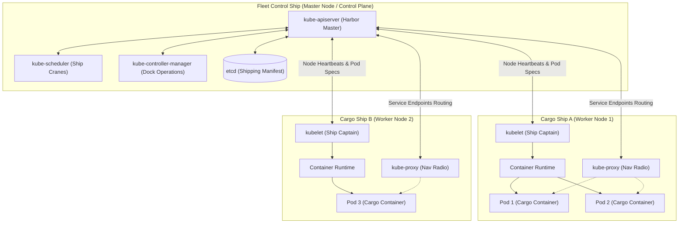

# Analogy of Kubernetes: Visual & Intuitive Guide to K8s Architecture

**Discover Kubernetes through simple, relatable maritime analogies and illustrations that make complex distributed cloud architecture effortless to understand.**

[Analogy Matrix](#analogy-mapping-matrix) • [Architecture Diagram](#kubernetes-fleet-architecture) • [Control Plane Analogies](#control-ship-the-master-node) • [Worker Node Analogies](#now-lets-talk-about-about-worker-node)

---

## Learn Kubernetes the Intuitive Way

Understanding Kubernetes doesn't have to be complicated or overwhelming. This project uses relatable real-world analogies—comparing a Kubernetes cluster to a modern cargo shipping fleet and harbor docks—to break down every core abstraction into simple mental models.

---

## Analogy Mapping Matrix

| Real-World Maritime Analogy | Kubernetes Component | Cluster Role & Responsibilities |
|---|---|---|
| 🚢 **Fleet Control Flagship** | **Control Plane (Master Node)** | Oversees cluster health, schedules workloads, maintains desired state |
| 📡 **Harbor Master & Radio Hub** | **`kube-apiserver`** | Central communication hub exposing the REST API for `kubectl` & components |
| 🏗️ **Port Loading Cranes** | **`kube-scheduler`** | Assigns newly created Pods to optimal Worker Nodes based on capacity & affinity |
| 📋 **Central Shipping Manifest** | **`etcd` Distributed Store** | Highly available, consistent key-value store holding complete cluster state |
| 👮 **Dock Operations Managers** | **`kube-controller-manager`** | Regulates replication, node lifecycles, endpoints, and desired state drift |
| 🚢 **Cargo Transport Ships** | **Worker Nodes** | Physical or virtual machines providing CPU/RAM to execute application workloads |
| 🧑‍✈️ **Ship Captain** | **`kubelet`** | Node agent ensuring assigned Pods and containers are running healthy |
| 📻 **Navigation Radio & Router** | **`kube-proxy`** | Manages networking rules (iptables/IPVS) and routes traffic across Pods & Services |
| 📦 **Standard Cargo Containers** | **Pods** | Smallest deployable unit in K8s, encapsulating one or more container instances |
| ⚙️ **Container Handling Machinery**| **Container Runtime (`containerd`/Docker)** | Low-level engine that pulls container images and executes processes |

---

## Kubernetes Fleet Architecture

---

# Visual Analogy Gallery

Below are the visual breakdowns explaining each Kubernetes concept in detail:

## Cargo Ships: The Worker Nodes
Imagine a cargo ship as a worker node in Kubernetes. Just like a cargo ship carries containers, a worker node runs the pods that house your application containers.

## Control Ship: The Master Node
In a fleet of cargo ships, there’s always a control ship that oversees and manages all the other ships. Similarly, the master node in Kubernetes manages all the worker nodes, ensuring they operate smoothly and efficiently.

## Ship Cranes: The Kube Scheduler
Ship cranes are responsible for placing containers onto cargo ships, just as the Kubernetes scheduler assigns pods to worker nodes. The scheduler ensures that the containers (pods) are distributed according to the resources and policies you've set.

## Cargo Data Management: The ETCD Cluster
Every movement of containers on and off cargo ships is meticulously recorded to track where each container has been. In Kubernetes, this concept is mirrored by the ETCD cluster, which stores all the configuration data and states of the cluster.

## Dock Offices: Kubernetes Control Components

## Controllers: Ensuring Smooth Operations

## Communication in the Fleet: Kube API Server
Kube API Server: Acts as the communication hub for the entire Kubernetes cluster, facilitating interactions between components.

## Now Let's talk about about Worker Node.

## Kubelet: The Ship's Captain
Every cargo ship has a captain who ensures the ship runs smoothly, follows its planned course, and handles any issues that arise during the journey. In Kubernetes, the kubelet acts like the ship's captain. It's an agent that runs on each worker node, making sure that the containers (pods) assigned to that node are running as expected. The kubelet communicates with the master node to report the status of the node and the pods running on it.

## Kube-Proxy: The Fleet's Communication System
For cargo ships to work together efficiently, they need a robust communication system that allows them to exchange information and coordinate their activities. In Kubernetes, this role is filled by kube-proxy. The kube-proxy handles network communication for each node, ensuring that traffic is routed correctly between services and pods. It enables different parts of your application to communicate with each other, much like how ships in a fleet coordinate to navigate their routes.

## Pods: The Smallest Unit of Kubernetes
In Kubernetes, pods are the smallest deployable units, similar to individual containers on a cargo ship. Each pod contains one or more containers, which run your application workloads.

## Docker Container Runtime: The Cargo Handling Mechanism
Just as cargo ships need cranes and machinery to load and unload containers, Kubernetes uses a container runtime to manage the containers within its pods. Docker is one of the most popular container runtimes used in Kubernetes. It provides the environment in which containers are run, ensuring they are isolated, secure, and can operate independently of each other, similar to how each container on a ship is packed and transported securely.

# Conclusion
Kubernetes can be complex, but by using everyday analogies, we’ve made its concepts easier to understand. Like a well-organized dock, Kubernetes efficiently manages the movement and storage of your applications.

This guide simplifies the learning process, helping you grasp Kubernetes basics quickly. Keep exploring and experimenting—Kubernetes is a powerful tool that will elevate your application management skills.

Happy learning!

